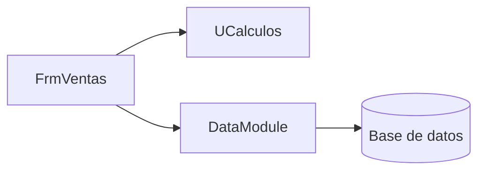
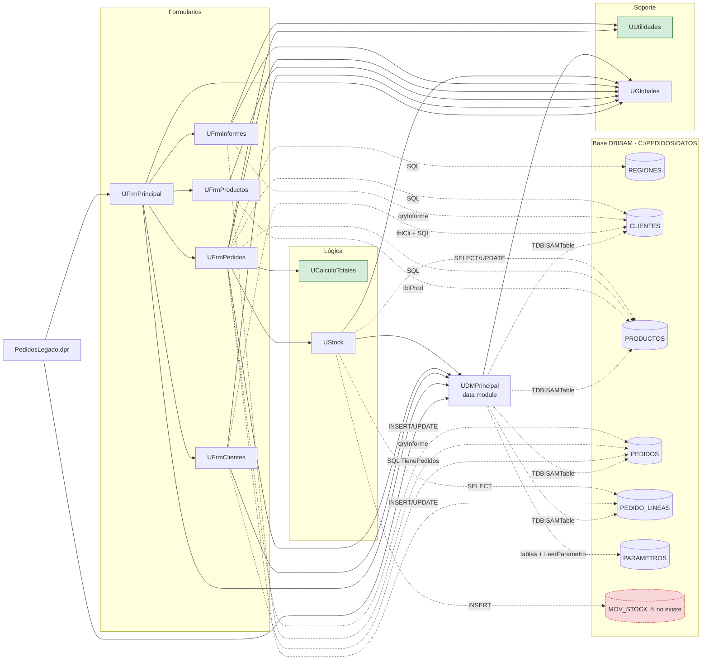

# Dependencias de Pedidos Legado

<!--
Etapa 1 · Entender (plan mode).
Dibuja quién usa a quién: unidades, formularios y la base de datos.
- Una flecha A --> B significa «A usa a B» (lo ves en la cláusula uses o en una consulta SQL).
- Incluye la base de datos (DBISAM) como un nodo: es parte del sistema.
Punto de control E1: el diagrama incluye la base de datos.

Ejemplo genérico (de otro sistema, no de este):

-->

**Leyenda:**
- `-->` (línea continua): dependencia por cláusula `uses`.
- `-.->` (línea punteada): acceso directo a la base, por SQL o por un componente DBISAM propio.
- Las tablas están dentro de la base DBISAM. `MOV_STOCK` aparece marcada porque no existe en el esquema.

Evidencia de cada flecha:
- **`uses`:** `PedidosLegado.dpr:3-14` y `:21-22`, `UFrmPrincipal.pas:38-39`, `UFrmClientes.pas:55`, `UFrmProductos.pas:36`, `UFrmPedidos.pas:9` y `:67`, `UFrmInformes.pas:46`, `UStock.pas:15`, `UDMPrincipal.pas:36`.
- **Base:** `UDMPrincipal.dfm:9-60` y `UDMPrincipal.pas:85`, `UFrmClientes.dfm:200` y `.pas:76,160,207`, `UFrmProductos.dfm:85-89`, `UFrmInformes.pas:65-67`, `UFrmPedidos.pas:99-102,151-152,249,259-321,338`, `UStock.pas:23,51,64,85`.

Los nodos en verde son unidades puras: no usan formularios, el data module ni la base.

## Preguntas guía

1. **¿Qué unidad usan casi todas las demás? ¿Qué pasaría si cambia?**
   `UGlobales`: la usan los 5 formularios, `UStock` y `UDMPrincipal` (7 de 9 unidades). Son variables mutables que «se modifican desde varios formularios» (`UGlobales.pas:4`). Un cambio en ella (por ejemplo en `gTasaIVA`, `gNivelUsuario` o `gRutaDatos`) afecta cálculos, permisos y conexión en todo el sistema, y como es estado compartido es difícil saber quién la escribe. Le sigue `UDMPrincipal`, que usan 4 unidades.

2. **¿Qué unidad no depende de formularios ni de la base de datos? ¿Por qué eso importa para migrar?**
   `UCalculoTotales` (solo `SysUtils`) y `UUtilidades` (solo `SysUtils` y `DateUtils`). Son funciones puras: entran datos y salen resultados. Se pueden portar a `PedidosWeb.Core` tal cual y cubrir con tests xUnit que comparen contra el legado, sin levantar la UI ni la base. Son el primer paso de menor riesgo. Ojo: `UFrmPedidos` recalcula el total por su cuenta en vez de usar `UCalculoTotales` (ver `inventario.md`), así que hay que decidir cuál de las dos versiones es la regla correcta.
