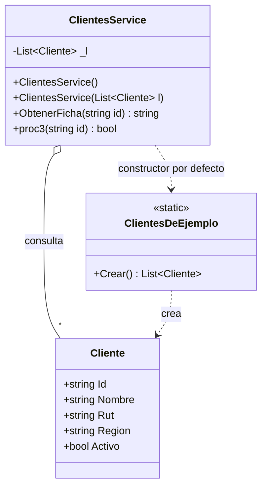

# Módulo Clientes

Namespace: `PedidosWeb.Core.Clientes` · Carpeta: `src/PedidosWeb.Core/Clientes/`
Tests: `tests/PedidosWeb.Core.Tests/Clientes/ClientesServiceTests.cs`

## Propósito

Representa a los clientes de la distribuidora y entrega dos consultas sobre ellos:

- la **ficha** del cliente en una sola línea de texto, lista para mostrar en pantalla, con el RUT normalizado y la zona geográfica;
- si un cliente **existe y está activo**.

Los datos vienen de una lista en memoria (`ClientesDeEjemplo`, 8 clientes ficticios). Los RUT están escritos como en Pedidos Legado: a veces con puntos, con espacios o con la «k» en minúscula; el servicio los normaliza al armar la ficha.

> Hoy ningún endpoint de `PedidosWeb.Api` usa este módulo (no está registrado en `Program.cs`). Solo lo ejercitan sus tests.

## API pública

### `Cliente` (clase)

| Propiedad | Tipo | Descripción |
|-----------|------|-------------|
| `Id` | `string` | Identificador, p. ej. `"C-001"`. |
| `Nombre` | `string` | Razón social o nombre de fantasía. |
| `Rut` | `string` | RUT tal como viene del legado (sin normalizar). |
| `Region` | `string` | Región en número romano: `"RM"`, `"II"`, `"V"`, `"VIII"`. |
| `Activo` | `bool` | Si el cliente está habilitado. |

### `ClientesDeEjemplo` (clase estática)

- `static List<Cliente> Crear()` — devuelve una lista nueva con los 8 clientes de ejemplo (`C-001` a `C-008`). `C-007` (Kiosco Central) es el único inactivo.

### `ClientesService` (clase)

| Miembro | Descripción |
|---------|-------------|
| `ClientesService()` | Usa los clientes de `ClientesDeEjemplo.Crear()`. |
| `ClientesService(List<Cliente> l)` | Usa la lista entregada (útil en tests). |
| `string ObtenerFicha(string id)` | Devuelve `"<Nombre> \| <RUT> \| <Zona> \| <Estado>"`, o `""` si el id no existe. |
| `bool proc3(string id)` | `true` si el cliente existe y está activo; `false` si no existe o está inactivo. |

**Reglas de `ObtenerFicha`:**

- **RUT:** quita puntos y espacios y pasa a mayúsculas (`76.990.011-k` → `76990011-K`; `76 432 198-7` → `76432198-7`).
- **Zona** según `Region`:

  | Región | Zona |
  |--------|------|
  | `RM`, `V` | Zona centro |
  | `VIII` | Zona sur |
  | `II` | Zona norte |
  | cualquier otra | Sin zona |

- **Estado:** `Activo` o `Inactivo` según la propiedad `Activo`.
- La búsqueda por `id` es exacta (distingue mayúsculas y minúsculas).

**Notas para el equipo**

- `proc3` mantiene el nombre heredado; no sigue la convención de nombres en español del proyecto.
- Los tests de `ObtenerFicha` todavía se llaman `Proc2_...`, nombre anterior del método.
- El servicio no expone la lista de clientes ni búsqueda por RUT o región.

## Ejemplo de uso

Basado en `ClientesServiceTests`:

```csharp
using PedidosWeb.Core.Clientes;

var servicio = new ClientesService(); // clientes de ejemplo

servicio.ObtenerFicha("C-001"); // "Ferretería El Clavo | 76123456-0 | Zona centro | Activo"
servicio.ObtenerFicha("C-004"); // "Almacén La Esquina | 76990011-K | Zona centro | Activo"
servicio.ObtenerFicha("C-999"); // ""

servicio.proc3("C-001"); // true
servicio.proc3("C-007"); // false (inactivo)
servicio.proc3("C-999"); // false (no existe)

// Con una lista propia:
var propio = new ClientesService(new List<Cliente>
{
    new Cliente { Id = "X-1", Nombre = "Cliente de prueba", Rut = "11.111.111-1", Region = "XV", Activo = false },
});
propio.ObtenerFicha("X-1"); // "Cliente de prueba | 11111111-1 | Sin zona | Inactivo"
```

## Diagrama


